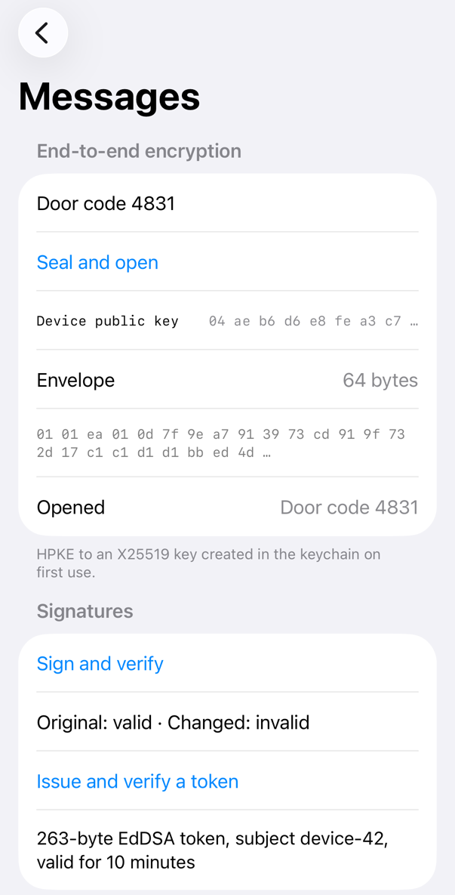

<!-- i18n-source: README.md@9d0fcb1711e79058fe8846d4e13964cac6689083 status=reviewed -->
<!-- brand:start -->

<p align="center"><picture><source media="(prefers-color-scheme: dark)" srcset="https://raw.githubusercontent.com/muhittincamdali/iOSSecurityTools/master/.github/brand/banner-zh-CN-dark.svg"><source media="(prefers-color-scheme: light)" srcset="https://raw.githubusercontent.com/muhittincamdali/iOSSecurityTools/master/.github/brand/banner-zh-CN-light.svg"></picture></p>

<!-- lang-selector:start -->
<p align="center"><a href="README.md">English</a> · <a href="README.tr.md">Türkçe</a> · <a href="README.zh-CN.md">简体中文</a> · <a href="README.ja.md">日本語</a> · <a href="README.ko.md">한국어</a> · <a href="README.es.md">Español</a> · <a href="README.de.md">Deutsch</a> · <a href="README.fr.md">Français</a> · <a href="README.pt-BR.md">Português (Brasil)</a> · <a href="README.ru.md">Русский</a></p>
<!-- lang-selector:end -->

<p align="center">
<a href="https://github.com/muhittincamdali/iOSSecurityTools/actions/workflows/ci.yml"></a>
<a href="https://github.com/muhittincamdali/iOSSecurityTools/releases"><picture><source media="(prefers-color-scheme: dark)" srcset="https://raw.githubusercontent.com/muhittincamdali/iOSSecurityTools/master/.github/brand/badge-version-dark.svg"><source media="(prefers-color-scheme: light)" srcset="https://raw.githubusercontent.com/muhittincamdali/iOSSecurityTools/master/.github/brand/badge-version-light.svg"></picture></a>
<a href="https://github.com/muhittincamdali/iOSSecurityTools/blob/master/Package.swift"><picture><source media="(prefers-color-scheme: dark)" srcset="https://raw.githubusercontent.com/muhittincamdali/iOSSecurityTools/master/.github/brand/badge-platforms-dark.svg"><source media="(prefers-color-scheme: light)" srcset="https://raw.githubusercontent.com/muhittincamdali/iOSSecurityTools/master/.github/brand/badge-platforms-light.svg"></picture></a>
<a href="https://github.com/muhittincamdali/iOSSecurityTools/blob/master/Package.swift"><picture><source media="(prefers-color-scheme: dark)" srcset="https://raw.githubusercontent.com/muhittincamdali/iOSSecurityTools/master/.github/brand/badge-language-dark.svg"><source media="(prefers-color-scheme: light)" srcset="https://raw.githubusercontent.com/muhittincamdali/iOSSecurityTools/master/.github/brand/badge-language-light.svg"></picture></a>
<a href="https://github.com/muhittincamdali/iOSSecurityTools/blob/master/LICENSE"><picture><source media="(prefers-color-scheme: dark)" srcset="https://raw.githubusercontent.com/muhittincamdali/iOSSecurityTools/master/.github/brand/badge-license-dark.svg"><source media="(prefers-color-scheme: light)" srcset="https://raw.githubusercontent.com/muhittincamdali/iOSSecurityTools/master/.github/brand/badge-license-light.svg"></picture></a>
</p>

<p align="center">
<a href="#快速开始"><picture><source media="(prefers-color-scheme: dark)" srcset="https://raw.githubusercontent.com/muhittincamdali/iOSSecurityTools/master/.github/brand/button-start-zh-CN-dark.svg"><source media="(prefers-color-scheme: light)" srcset="https://raw.githubusercontent.com/muhittincamdali/iOSSecurityTools/master/.github/brand/button-start-zh-CN-light.svg"></picture></a>
<a href="https://muhittincamdali.github.io/iOSSecurityTools/documentation/iossecuritytools/"><picture><source media="(prefers-color-scheme: dark)" srcset="https://raw.githubusercontent.com/muhittincamdali/iOSSecurityTools/master/.github/brand/button-docs-zh-CN-dark.svg"><source media="(prefers-color-scheme: light)" srcset="https://raw.githubusercontent.com/muhittincamdali/iOSSecurityTools/master/.github/brand/button-docs-zh-CN-light.svg"></picture></a>
<a href="https://github.com/muhittincamdali/iOSSecurityTools/tree/master/Examples"><picture><source media="(prefers-color-scheme: dark)" srcset="https://raw.githubusercontent.com/muhittincamdali/iOSSecurityTools/master/.github/brand/button-examples-zh-CN-dark.svg"><source media="(prefers-color-scheme: light)" srcset="https://raw.githubusercontent.com/muhittincamdali/iOSSecurityTools/master/.github/brand/button-examples-zh-CN-light.svg"></picture></a>
</p>

> 本文是英文 README 的译文。如两者内容不一致，以英文版为准。

<!-- brand:end -->

一个面向 iOS、macOS、tvOS、watchOS 和 visionOS 应用的 Swift 安全组件包：钥匙串存储、认证加密、公钥加密、签名、签名令牌（JWT）、PIN 哈希、Secure Enclave 密钥、证书固定、一次性密码、设备完整性检查和日志脱敏。它适合希望正确实现这些功能、又不想研究 Security framework 的 C API 的应用开发者。每个类型都会校验收到的输入，并抛出带类型的错误而不是崩溃，因此来自二维码、服务器或文件的值不会让应用陷入崩溃。该软件包没有任何依赖。

## 亮点

- **无需手写字典的钥匙串** —— `Keychain` 可以存储数据、字符串和 `Codable` 值，在首次使用时创建加密密钥，并可要求 Face ID、Touch ID 或设备密码；这一限制由钥匙串本身强制执行，而不是靠 `LAContext` 外面的一个 `if`。
- **能发现篡改的加密** —— `DataCipher` 写出 AES-256-GCM 或 ChaCha20-Poly1305 信封，信封中自带版本、算法和 nonce；任何一个字节被改动、密钥错误或关联数据错误，都会导致解密失败。同时提供 HKDF、PBKDF2 和 PHC 格式的 PIN 哈希。
- **无需共享密钥的端到端加密** —— `PublicKeyCipher` 使用 HPKE（RFC 9180）把数据密封到设备的公钥上，因此服务器或其他用户可以发送只有该设备才能打开的内容；`SigningKey` 和 `VerifyingKey` 使用从原始字节、DER 或 PEM 读取的 Ed25519 或 P-256 密钥对数据进行签名和验证。
- **先检查再信任的令牌** —— `JWTVerifier` 从自己的密钥中确定算法，因此 `none` 令牌以及用公钥作为密钥的 `HS256` 令牌在读取任何内容之前就会失败；它还会检查签名、`exp`、`nbf`、`iss` 和 `aud`；`JWTSigner` 使用同样的密钥签发令牌。
- **不会把用户锁在门外的证书固定** —— `PinningPolicy` 要求提供备用 pin，支持子域名、过期日期和仅报告模式，并且仍要求系统自身的信任评估通过。
- **提供信号，而非承诺** —— `IntegrityInspector` 以 `Codable` 报告的形式给出越狱文件、调试器、模拟器、hook 库和系统代理的检测结果；文档也会说明攻击者能够隐藏哪些内容。
- **机密不会出现在日志和截图中** —— `@Redacted` 在任何地方都输出 `<redacted>`；`SensitiveDataRedactor` 会清除银行卡号、电子邮件、token 和机密字段；`.privacyShield()` 会在 App 切换器和屏幕录制期间遮住视图。脱敏器只把纯 ASCII 的键与机密名称比较，其他任何键默认都会被脱敏；JSON、表单和 multipart 请求体会经过解析，无法解析的请求体以及服务器可能以不同方式拆分字段的请求体会被省略。自由文本在第一个触发点处截断：安全字母表之外的字符、转义序列、长单词、不被允许的键或机密名称。
- **经受过恶意输入的测试** —— RFC 4226、6238、5869、7748、8032 和 4231 的测试向量，由独立实现生成的信封、哈希、签名和令牌，来自测试 PKI 的证书链，NaN 和无穷大的日期，`Int.min` 和 `Int.max`，过大和重复的 URI 参数，伪造的令牌头：在 macOS 和 iPhone 模拟器上共有 676 个 Swift Testing 测试，另外还有示例应用内部的钥匙串测试套件。

### 包含的内容

| 领域 | 类型 |
| --- | --- |
| 钥匙串 | `Keychain`, `KeychainAccessibility`, `KeychainProtection`, `KeychainError` |
| 加密与哈希 | `DataCipher`, `KeyDerivation`, `PasswordKeyDerivation`, `PasswordHash`, `MessageAuthenticator`, `SecureRandom`, `ConstantTime` |
| 端到端加密 | `PublicKeyCipher`, `KeyDerivation.sharedKey(privateKey:peerPublicKey:salt:info:outputByteCount:)`, `Keychain.keyAgreementKey(forKey:)` |
| 签名 | `SigningKey`, `VerifyingKey`, `SignatureAlgorithm`, `Keychain.signingKey(forKey:algorithm:)` |
| 签名令牌 | `JWTVerifier`, `JWTSigner`, `JWTClaims`, `JWTAlgorithm` |
| Secure Enclave | `SecureEnclaveKey`, `Keychain.secureEnclaveKey(forKey:protection:)` |
| 生物识别 | `BiometricAuthenticator`, `BiometricError` (iOS, macOS, visionOS) |
| 证书固定 | `PinningPolicy`, `PinnedDomain`, `SPKIPin`, `PinningURLSessionDelegate`, `URLSession.pinned(policy:)` |
| 一次性密码 | `TOTP`, `HOTP`, `OTPAuthURI` |
| 设备完整性 | `IntegrityInspector`, `IntegrityReport`, `IntegrityFinding` |
| 日志与屏幕 | `Redacted`, `Mask`, `SensitiveDataRedactor`, `.privacyShield(when:)`, `.onScreenshot(perform:)` |

## 快速开始

**1. 添加软件包**

在 Xcode 中选择 **File › Add Package Dependencies…**，然后输入仓库地址：

```text
https://github.com/muhittincamdali/iOSSecurityTools.git
```

将地址粘贴到窗口右上角的搜索框中。保持 **Dependency Rule** 为从 `2.2.0` 起的 **Up to Next Major Version**，然后点击 **Add Package**。在下一个窗口中，在 **iOSSecurityTools** 旁选择你的 App target，再次点击 **Add Package**。

**2. 导入模块**

```swift
import iOSSecurityTools
```

把这一行放在使用该软件包的 Swift 文件顶部，位于 `import SwiftUI` 之下。

**3. 开始使用**

在一个新的 Xcode App 项目中（**File › New › Project… › App**），用下面的代码替换 `ContentView.swift` 的全部内容：

```swift
import SwiftUI
import iOSSecurityTools

struct ContentView: View {
    @State private var status = "Nothing stored yet"

    var body: some View {
        VStack(spacing: 16) {
            Text(status)
            Button("Encrypt and store a note") {
                do {
                    let keychain = Keychain(service: "QuickStart")
                    let cipher = try DataCipher(key: keychain.symmetricKey(forKey: "notes-key"))
                    try keychain.set(cipher.encrypt("Meet at 7 pm"), forKey: "note")

                    let stored = try keychain.data(forKey: "note") ?? Data()
                    status = "Decrypted: \(try cipher.decryptString(stored))"
                } catch {
                    status = error.localizedDescription
                }
            }
            .buttonStyle(.borderedProminent)
        }
        .padding()
        .privacyShield()
    }
}
```

选择一个 iPhone 模拟器并点击 **Run**（⌘R）。点击按钮后，应用会在钥匙串中创建一个密钥，用它加密这条笔记，存储加密后的字节，再读回并显示 "Decrypted: Meet at 7 pm"。`.privacyShield()` 会在应用进入后台时用一个锁屏覆盖画面，因此 App 切换器不会显示这条笔记。

## 安装

### Swift Package Manager

在 Xcode 中选择 **File › Add Package Dependencies…**，然后输入仓库地址：

```text
https://github.com/muhittincamdali/iOSSecurityTools.git
```

或者将其添加到 `Package.swift` 的 `dependencies` 中：

```swift
dependencies: [
    .package(url: "https://github.com/muhittincamdali/iOSSecurityTools.git", from: "2.2.0")
],
targets: [
    .target(name: "YourApp", dependencies: [
        .product(name: "iOSSecurityTools", package: "iOSSecurityTools")
    ])
]
```

2.2.0 版本接管了已归档的 SwiftCrypto-Pro 中的公钥加密、签名、HMAC 和令牌代码；其中的类型与本包中类型的对应关系见 [CHANGELOG](CHANGELOG.md)。

2.0.0 版（2026 年 10 月）是当前软件包的首个发布版本。更早的 1.0.0 版（2026 年 2 月）是另一套代码：2026 年 6 月，它的源代码被替换成了占位代码，2026 年 10 月，该软件包连同测试一起被完全重写。变更列表见 [CHANGELOG.md](CHANGELOG.md)。

macOS 应用要使用钥匙串，需要在 **Signing & Capabilities** 中设置开发团队；iOS 应用和模拟器无需额外设置。若要使用 Face ID，请在应用的 Info.plist 中添加 `NSFaceIDUsageDescription`。

## 使用方法

下面的示例复制自 [`Examples/SecurityLab/SecurityLab/ReadmeSamples.swift`](Examples/SecurityLab/SecurityLab/ReadmeSamples.swift)。示例应用和测试套件都会编译这个文件，测试会运行其中不需要弹出提示或联网的示例。

### 在钥匙串中存储 token

```swift
func keychainSample() throws -> String? {
    let keychain = Keychain(service: "com.example.app.credentials")
    try keychain.set("r-7f3a9c", forKey: "refreshToken")
    let token = try keychain.string(forKey: "refreshToken")   // "r-7f3a9c"
    try keychain.removeValue(forKey: "refreshToken")
    return token
}
```

### 要求用 Face ID 访问某个值

```swift
func protectedValueSample() throws -> String? {
    let keychain = Keychain(service: "com.example.app.cards")
    // Only the biometry enrolled now can read the value; the system enforces it.
    try keychain.set("4921", forKey: "card-pin", protection: .biometryCurrentSet)
    return try keychain.string(forKey: "card-pin", prompt: "Show your card PIN")
}
```

### 加密一条记录

```swift
func encryptionSample() throws -> String {
    let cipher = try DataCipher(key: DataCipher.generateKey())
    let recordID = Data("note-42".utf8)

    // The record ID is authenticated, so this envelope cannot be pasted into another record.
    let envelope = try cipher.encrypt("Meet at 7 pm", authenticating: recordID)
    return try cipher.decryptString(envelope, authenticating: recordID)   // "Meet at 7 pm"
}
```

### 发送只有一台设备能读取的消息

```swift
func endToEndSample() throws -> String {
    // On the receiving device: create a key pair once and publish the 32-byte public key.
    let deviceKey = PublicKeyCipher.PrivateKey()   // or Keychain.keyAgreementKey(forKey:)
    let published = deviceKey.publicKey.rawRepresentation

    // On any sender, your server included: no shared secret needed.
    let recipient = try PublicKeyCipher.publicKey(rawRepresentation: published)
    let envelope = try PublicKeyCipher.seal("See you at 7", to: recipient)

    // Back on the device: only its private key opens the envelope.
    return try PublicKeyCipher.openString(envelope, using: deviceKey)   // "See you at 7"
}
```

信封不会说明发送者是谁，任何记录下它的人都可以再次发送：[端到端指南](https://muhittincamdali.github.io/iOSSecurityTools/documentation/iossecuritytools/encryptingendtoend)介绍了发送者认证、消息编号，以及用于长对话的密钥协商。

### 对数据签名并验证

```swift
func signatureSample() throws -> Bool {
    let signingKey = SigningKey()                     // Ed25519; SigningKey(algorithm: .p256) for P-256
    let export = Data("orders.csv contents".utf8)
    let signature = try signingKey.signature(for: export)

    // Anyone with the public key (raw, DER or PEM) can check the file.
    let publicKey = try VerifyingKey(pemRepresentation: signingKey.publicKey.pemRepresentation)
    return publicKey.isValidSignature(signature, for: export)   // true
}
```

### 验证签名令牌

```swift
func tokenSample() throws -> String? {
    // Your server signs the token; here a key made in place stands in for it.
    let serverKey = SigningKey()
    let token = try JWTSigner(signingKey: serverKey).sign(JWTClaims(
        issuer: "https://auth.example.com", subject: "user-42", audience: ["ios-app"],
        expiration: Date().addingTimeInterval(600)
    ))

    // The app checks the signature, the algorithm, exp, nbf, iss and aud before trusting it.
    let verifier = try JWTVerifier(publicKey: serverKey.publicKey,
                                   issuer: "https://auth.example.com", audience: "ios-app")
    return try verifier.verify(token).subject   // "user-42"
}
```

[令牌指南](https://muhittincamdali.github.io/iOSSecurityTools/documentation/iossecuritytools/verifyingsignedtokens)按顺序列出了每一项检查，以及不支持的内容（RSA、JWK 集合、加密令牌）。

### 校验应用锁 PIN

```swift
func pinSample() throws -> Bool {
    let stored = try PasswordHash.make(for: "4921")          // "$pbkdf2-sha256$i=600000$..."
    return try PasswordHash.verify("4921", against: stored)   // true
}
```

### 根据二维码显示一次性验证码

```swift
func oneTimePasswordSample() throws -> Bool {
    let scanned = "otpauth://totp/Example:alice@example.com?secret=JBSWY3DPEHPK3PXP&issuer=Example"
    let uri = try OTPAuthURI(parsing: scanned)
    guard case .totp(let totp) = uri.kind else { return false }

    let code = try totp.code()                    // six digits, new every 30 seconds
    let secondsLeft = try totp.secondsRemaining()
    print("\(uri.issuer ?? ""): \(code), \(secondsLeft) s left")
    return try totp.verify(code)                   // also accepts the previous and next code
}
```

### 固定服务器的密钥

```swift
func pinnedSessionSample() throws -> URLSession {
    let policy = try PinningPolicy([
        PinnedDomain("letsencrypt.org", pins: [
            "C5+lpZ7tcVwmwQIMcRtPbsQtWLABXhQzejna0wHFr8M=",   // ISRG Root X1
            "diGVwiVYbubAI3RW4hB9xU8e/CH2GnkuvVFZE8zmgzI=",   // ISRG Root X2
        ], includesSubdomains: true),
    ])
    return URLSession.pinned(policy: policy) { failure in
        print("Blocked: \(failure.localizedDescription)")
    }
}
```

[证书固定指南](https://muhittincamdali.github.io/iOSSecurityTools/documentation/iossecuritytools/pinningcertificates)介绍了如何获取你自己服务器的 pin，以及如何在不把用户锁在门外的前提下逐步上线。

### 检查设备

```swift
func integritySample() -> IntegrityReport {
    let report = IntegrityInspector().inspect()
    if report.hasFindings(in: [.jailbreak, .injectedLibraries]) {
        // Add friction: ask for the passcode again, lower limits, flag the session on the server.
    }
    for finding in report.findings {
        print(finding)   // for example "Running in the simulator"
    }
    return report
}
```

### 让机密远离日志

```swift
struct LoginRequest: Codable {
    var username: String
    @Redacted var password: String
}

func redactionSample() -> (request: String, log: String) {
    let request = LoginRequest(username: "alice", password: "hunter2")
    let printed = "\(request)"   // LoginRequest(username: "alice", _password: <redacted>)

    let redactor = SensitiveDataRedactor()
    let log = redactor.redact("charged 4242 4242 4242 4242 to alice@example.com, token=eyJhbGciOiJIUzI1NiJ9.eyJzdWIiOiIxIn0.c2ln")
    // "charged •••• 4242 to a•••@example.com, token=[redacted]"
    return (printed, log)
}
```

`SensitiveDataRedactor` 只把纯 ASCII 的键（`A`–`Z`、`a`–`z`、`0`–`9`、`_`、`-`、`.` 和空格）与机密名称比较。形近字母、不可见字符和转义序列都可能伪装机密名称，因此其他任何键的值默认都会被脱敏。JSON、表单和 multipart 请求体由解析器读取；无法完整解析的请求体会以 `[body omitted: N bytes, <type>]` 的形式省略。常见服务器解析器可能以不同方式拆分字段的请求体（例如单独换行符之后的 multipart 边界，或含有 `;` 的表单）也同样会被省略。超过 256 KiB 的请求体同样会被省略（`maximumBodySize`；应用可以调高这一上限，代价是请求体每个字节最多约占 40 字节内存）；JSON 最多读取 64 层对象和数组以及 4 层相互嵌套的文档（字符串中的 JSON 也计算在内），因此恶意输入可占用的栈空间是有上限的；包含更多层的字符串会被整体脱敏。在一个输入中找到的所有文档合计最多读取输入长度的四倍，因此耗时也有上限；超出这一预算的文本会被整体脱敏；由 2^28 个（256 Mi）或更多 Unicode 标量组成的文本也会不经读取而被整体脱敏。名称和值分处两处的字段（如 `{"name":"X-Api-Key","value":…}`、针对 `/password` 的 JSON Patch 或 SCIM 操作，以及 `[["Authorization","…"]]`），只要名称是机密名称或不是纯 ASCII，其值就会被整体脱敏。既不是由 ASCII 标签组成的名称、也不是地址，含有卡号或令牌，或者指向机密名称的 URL 主机（`myapp://pin/4831` 的主机是 `pin`；`https://pin-4831.example.com` 的主机本身就含有值），会写成 `scheme://[redacted]`，不带端口、路径和查询；multipart 部分的头部名称只有在属于部分所携带的头部时才会写出；各部分头部的值只写出 `Content-Length`（1 到 12 位 ASCII 数字）和 `Content-Transfer-Encoding`（`7bit`、`8bit`、`binary`、`base64` 或 `quoted-printable`），按这种形式写出，从不作为自由文本读取，其他任何值都会变成 `[redacted]`。路径段超过 64 个或参数超过 128 个的 URL，以及路径会被不同服务器解析成不同段的 URL（如 `/pin/./4831` 中的点段、`/a;pin/4831` 中的 `;`、转义的 `.`、`/`、`\`、`;` 或 `%`），只记录协议和主机。电子邮件地址无论使用哪种文字，都只显示名称的第一个字母（`ayşe.yılmaz@gmail.com` 会变成 `a•••@gmail.com`）。非 ASCII 的名称即使作为值写出，也视为机密名称：承载名称的字段（`name`、`label`、`type`、`id` 等）若为 `Şifre`、`ⓟⓘⓝ` 或 `🔑` 这样的名称，其旁边的值会被脱敏。含有换行或其他控制字符的名称，在承载名称的字段中无论内容如何都视为机密名称，在其他位置则在去掉控制字符或把它们读作空格后构成机密名称时才视为机密名称（`{"ParameterKey":"DbPassword\n","ParameterValue":…}`）；只由控制字符组成的短字符串（`"\n"`）也视为机密名称，而 `{"message":"Hello\nWorld","id":"7"}` 会保留 `id`；在 `redact(url:)` 中，不是纯 ASCII 名称的路径段之后的那一段会变成 `:id`（`/şifre/…`、`/a,b/…`）。在自由文本中，第一个机密名称会隐藏该文本中它之后的所有内容；这是有意多隐藏。多隐藏是设计上的选择。文本在哪里被截断由六条规则决定，没有一条维护变体列表：安全字母表（任何文字的字母、附加符号和数字，ASCII 空格、制表符和换行，以及可打印 ASCII）之外的第一个字符，因此像 `꞉` 或 `→` 这样的形近分隔符、表情符号或控制字符都会截断文本，兼容分解形式不在该字母表内的字母或数字（`🄁` 即 `0,`）也会截断文本；任何从不解码的转义序列（`%3D`、`&colon;`、`\075`）——在自由文本中，每个反斜杠转义都会截断文本，即后面不是 ASCII 空格、制表符或换行的任何反斜杠（`login pa\x{73}sword hunter2` 只保留 `login `，像 `\\nas\backup` 这样的 Windows 路径也会从第一个反斜杠起被隐藏）；超过 256 个字符的单词；不被允许的键（`status`、`method`、`path`、`duration_ms`、`count` 以及你传入的键之外的任何键），也包括加任何一种引号（`"`、`'`、反引号）的键（此时从开引号处截断文本：`cache miss for "session Qz9Wk7rX": refetching` 会变成 `cache miss for [redacted]`），以及作为二元素数组的第一个字符串出现的键；标记标签：在自由文本中，第一个标记标签会截断文本，无论是什么标签（`<user>`、`<_id>`、`</a>`、`<!--`）：后面既不是 ASCII 空格、制表符、换行或数字，也不是 `=` 或文本末尾的 `<` 都会截断文本；以及机密名称，无论有无分隔符，也包括像 `name="password"` 这样作为值写出的名称。单词按其 ASCII 骨架、依照一条通配规则比较：没有 ASCII 形式的非 ASCII 字母、附加符号或数字，既可算作没有，也可算作任意一个字母，因此 `piꞏn`、`tokeın` 和 `tokenꞏs` 读作 `pin`、`token` 和 `tokens`，替换名称中一个字母的单个这样的字符能被找到（`pɑssword`、`tͦken`、`passw〇rd` 和 `t၀ken`：其他文字的十进制数字也属于这类数字）。在同一行内没有闭合的引号会从该引号处截断文本，因此内部含有换行的带引号的键什么也不会显示。文本被截到末尾，而不只是截到行尾：`login user=bob status=401` 会变成 `login user=[redacted]`，写入日志的 multipart 正文从第一个头部开始被隐藏，属性列表从第一个标签开始被隐藏。自由文本中的 URL 只有在干净时才会显示：它由 `scheme://host` 和一个可选的、只含 ASCII 字母、数字、`.`、`_`、`-` 和 `/` 的路径组成，主机和各路径段都不是机密名称，并且后面紧跟空白、换行、文本末尾，或者在这些之前只有一个 `.`、`,`、`!` 或 `)`；其他任何 URL，包括后面跟着引号、`>`、反引号或 `?`、`#`、`;` 的 URL，都会从它开始的位置截断文本（`see https://x.example/a?page=2 ok` 和 `see https://x.example/a'#token` 会变成 `see [redacted]`；`allowedQueryParameters` 只适用于 `redact(url:)`）。数字之间的 `:` 只有在两侧都是同一形式的数字时才是数字的一部分（`12:30:45`、`10.0.0.1:8080`、`42:10`）；在以数字结尾的键（`user1:2345`）之后、在字母之前（`id 7:9hunter2`）或在五位及以上的数字之前（`1:482913`），它是分隔符。跨越垂直制表符、换页符或 Unicode 行分隔符写出的卡号、IBAN、电子邮件地址或令牌会被整体找到，文本从其开头起被隐藏。脱敏是安全网，不是保证：它为意外写入日志的机密而设计。结构化输入（JSON、表单、multipart 正文及其各部分的头部、URL 及其主机）默认是安全的，其中无法理解的内容都会被脱敏；结构化键的名称会显示，只隐藏其下的值。在自由文本中，没有分隔符、又有两个或更多字母被形近字母替换的名称（`pɑsswoʀd hunter2`），如果之前没有任何内容截断文本，就不保证能被找到：这是有意的伪装，而代替一个字母的单个字母、附加符号或数字能被找到（`tͦken hunter2`）。[日志指南](https://muhittincamdali.github.io/iOSSecurityTools/documentation/iossecuritytools/keepingsecretsoutoflogs)说明了自由文本的规则、它们的代价以及它们找不到的内容。

### 将账户绑定到设备

```swift
func deviceBindingSample(challenge: Data) throws -> (publicKey: Data, signature: Data)? {
    guard SecureEnclaveKey.isAvailable else { return nil }
    let key = try Keychain(service: "com.example.app.device").secureEnclaveKey(forKey: "device-key")
    // Send key.publicKeyDER to the server once; afterwards sign its login challenges.
    return (key.publicKeyDER, try key.signature(for: challenge))
}
```

## 已知限制

以下限制是已知的，尚未修改：

- 含有控制字符的名称，位于承载名称的字段或二元数组的第一个元素中时，无论内容如何都会隐藏旁边的成员（`{"name":"Hello\nWorld","value":"x"}` 会隐藏 `value`）；在其他位置，则在去掉控制字符或把它们读作空格后构成机密名称时隐藏（`{"note":"pass\nword","id":"7"}` 会隐藏 `id`）。
- 键只在 `token` 和 `secret` 作为单词或位于末尾、`pw` 作为单词时才计入，因此 `tokenvalue`、`TOKENID`、`secretvalue`、`secrethash`、`userpw` 和 `dbpw` 的值会显示出来；这类属性请用 `@Redacted` 标记。
- 只由控制字符和空白组成的短字符串，即使毫无意义也会隐藏旁边的所有成员（`{"title":"\n","data":"x"}` 会隐藏 `data`）；超过 256 个标量的字符串则作为文本读取。

## 演示

SecurityLab 示例应用在 iPhone 模拟器上的界面，由 [`scripts/capture-example-screens.sh`](scripts/capture-example-screens.sh) 从运行中的应用截取：

| 完整性 | 保险库 | 消息 |
| --- | --- | --- |
| <picture><source media="(prefers-color-scheme: dark)" srcset="docs/images/example-integrity-dark.png"></picture> | <picture><source media="(prefers-color-scheme: dark)" srcset="docs/images/example-vault-dark.png"></picture> | <picture><source media="(prefers-color-scheme: dark)" srcset="docs/images/example-messages-dark.png"></picture> |

| 一次性验证码 | 脱敏 | 隐私屏障 |
| --- | --- | --- |
| <picture><source media="(prefers-color-scheme: dark)" srcset="docs/images/example-codes-dark.png"></picture> | <picture><source media="(prefers-color-scheme: dark)" srcset="docs/images/example-redaction-dark.png"></picture> | <picture><source media="(prefers-color-scheme: dark)" srcset="docs/images/example-privacy-dark.png"></picture> |

要运行该应用，请用 Xcode 打开 [`Examples/SecurityLab`](Examples/SecurityLab) 中的 `SecurityLab.xcodeproj`，选择一个 iPhone 模拟器或 **My Mac**，然后点击 **Run**。应用中还包含快速开始示例、一个“消息”页面（把消息密封到设备的密钥上、对其签名，并验证签名令牌），以及一个证书固定页面，它会连接服务器并列出其证书链的 pin；详情见 [Examples/README.md](Examples/README.md)。

## 文档

API 参考文档与文章：

- [API 参考](https://muhittincamdali.github.io/iOSSecurityTools/documentation/iossecuritytools/)（DocC，从 `master` 发布到 GitHub Pages）
- 在 Xcode 中通过 **Product › Build Documentation** 在本地构建，或使用命令行：

```sh
xcodebuild docbuild -scheme iOSSecurityTools -destination 'generic/platform=macOS'
```

## 指南

- [快速入门](https://muhittincamdali.github.io/iOSSecurityTools/documentation/iossecuritytools/gettingstarted) —— 添加软件包，把一条笔记加密存入钥匙串，并遮住屏幕（[源文件](Sources/iOSSecurityTools/iOSSecurityTools.docc/GettingStarted.md)）。
- [存储机密](https://muhittincamdali.github.io/iOSSecurityTools/documentation/iossecuritytools/storingsecrets) —— 可访问性、生物识别保护、加密密钥、PIN 哈希和 Secure Enclave 密钥（[源文件](Sources/iOSSecurityTools/iOSSecurityTools.docc/StoringSecrets.md)）。
- [证书固定](https://muhittincamdali.github.io/iOSSecurityTools/documentation/iossecuritytools/pinningcertificates) —— 获取 pin、选择备用 pin、仅报告模式的逐步上线以及过期处理（[源文件](Sources/iOSSecurityTools/iOSSecurityTools.docc/PinningCertificates.md)）。
- [检测被入侵的设备](https://muhittincamdali.github.io/iOSSecurityTools/documentation/iossecuritytools/detectingcompromiseddevices) —— 每项完整性检查能看到什么、看不到什么，以及何时应使用 App Attest（[源文件](Sources/iOSSecurityTools/iOSSecurityTools.docc/DetectingCompromisedDevices.md)）。
- [端到端加密](https://muhittincamdali.github.io/iOSSecurityTools/documentation/iossecuritytools/encryptingendtoend) —— 设备密钥对、密封到公钥、发送者认证、签名和 HMAC（[源文件](Sources/iOSSecurityTools/iOSSecurityTools.docc/EncryptingEndToEnd.md)）。
- [验证签名令牌](https://muhittincamdali.github.io/iOSSecurityTools/documentation/iossecuritytools/verifyingsignedtokens) —— `JWTVerifier` 检查的内容、读取你自己的 claim，以及签发令牌（[源文件](Sources/iOSSecurityTools/iOSSecurityTools.docc/VerifyingSignedTokens.md)）。
- [让机密远离日志](https://muhittincamdali.github.io/iOSSecurityTools/documentation/iossecuritytools/keepingsecretsoutoflogs) —— `Redacted`、掩码、脱敏器和隐私屏障（[源文件](Sources/iOSSecurityTools/iOSSecurityTools.docc/KeepingSecretsOutOfLogs.md)）。

## 系统要求

| 平台 | 最低版本 |
| --- | --- |
| iOS | 17 |
| macOS | 14 |
| tvOS | 17 |
| watchOS | 10 |
| visionOS | 1 |
| 工具链 | Swift 6.2 · Xcode 26+ |

`BiometricAuthenticator` 在没有生物识别功能的 tvOS 和 watchOS 上不可用。CI 使用 GitHub `macos-26` runner 镜像自带的默认 Xcode 构建。该软件包使用 Xcode 27 开发。

## 架构

- `Sources/iOSSecurityTools/<Area>/` 中每个功能领域对应一个文件夹：`Keychain`、`Crypto`、`Signing`、`Tokens`、`Random`、`SecureEnclave`、`Biometrics`、`Pinning`、`OneTimePassword`、`Integrity`、`Redaction` 和 `Privacy`。除了 `URLSession` 要求必须是类的 `PinningURLSessionDelegate` 之外，所有类型都是 `Sendable` 的值类型。
- 软件包直接调用 Apple 的 framework —— 用 Security 处理钥匙串和信任评估，用 CryptoKit 处理 AES-GCM、ChaCha20-Poly1305、HPKE、X25519、Ed25519、ECDSA P-256、HKDF、HMAC 和 Secure Enclave，用 CommonCrypto 处理 PBKDF2，用 LocalAuthentication 处理生物识别 —— 只实现它们所缺少的部分：信封格式、用于 pin 和密钥的 SubjectPublicKeyInfo 与 PEM 编码、JWT 紧凑格式、HOTP/TOTP 截断、Base32、PHC 哈希格式和脱敏扫描器。软件包自身不包含任何密码、哈希或曲线运算。
- 错误是带类型的（`throws(KeychainError)`、`throws(CipherError)` 等），每个枚举 case 都有描述。来自应用外部的值会在执行任何处理之前先检查其限制。
- 读取系统状态的代码（完整性检查、`LAContext`）都经过小型的内部 protocol，因此测试可以用 fake 对象覆盖每个分支，同时也会检查真实的实现。
- 软件包不做什么，同样是设计的一部分：不使用 `ptrace` deny-attach，不使用 method swizzling，不读取私有的 dyld 结构。这些做法在不同系统版本之间容易失效，也很容易被绕过；[完整性指南](https://muhittincamdali.github.io/iOSSecurityTools/documentation/iossecuritytools/detectingcompromiseddevices)建议改用 App Attest。
- CI 会在 macOS 上运行 `swift test`，在 iPhone 模拟器上运行 `xcodebuild test`，为全部五个平台构建，为 iOS 和 macOS 构建示例应用，在应用内运行它的测试，并发布 DocC 文档。

在本地运行测试：

```sh
swift test                                    # macOS
swift test -c release                         # macOS, release build
xcodebuild test -scheme iOSSecurityTools \
  -destination 'platform=iOS Simulator,name=iPhone 17'
```

在模拟器上，没有宿主应用的测试 bundle 不具备钥匙串 entitlement，因此软件包的钥匙串测试套件在那里是在示例应用内运行的：

```sh
cd Examples/SecurityLab
xcodebuild test -scheme SecurityLab -destination 'platform=iOS Simulator,name=iPhone 17'
```

## 路线图

- 提供一个 App Attest 封装（`DCAppAttestService`），并附带服务端验证示例。
- 将该软件包加入 Swift Package Index；`.spi.yml` 已在仓库中。

## 参与贡献

欢迎参与贡献。提交 pull request 之前，请先阅读[贡献指南](https://github.com/muhittincamdali/iOSSecurityTools/blob/master/CONTRIBUTING.md)和[行为准则](https://github.com/muhittincamdali/.github/blob/main/CODE_OF_CONDUCT.md)。如发现安全问题，请按照[安全策略](https://github.com/muhittincamdali/iOSSecurityTools/blob/master/SECURITY.md)私下报告。

## 许可证

基于 MIT 许可证发布。详见 [LICENSE](LICENSE)。
