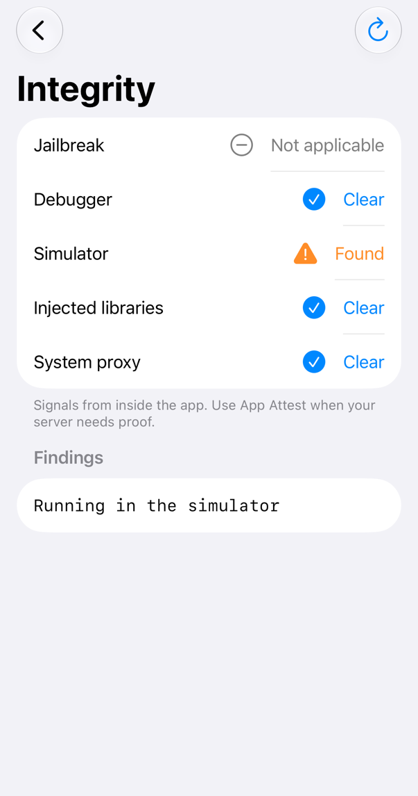
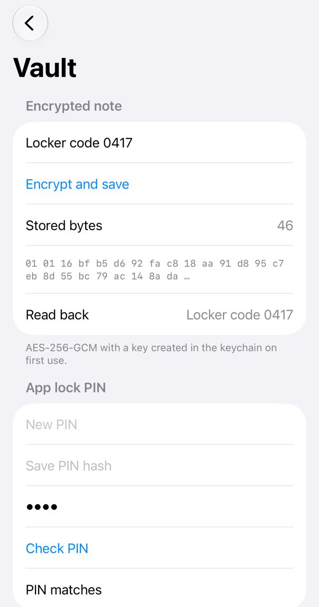
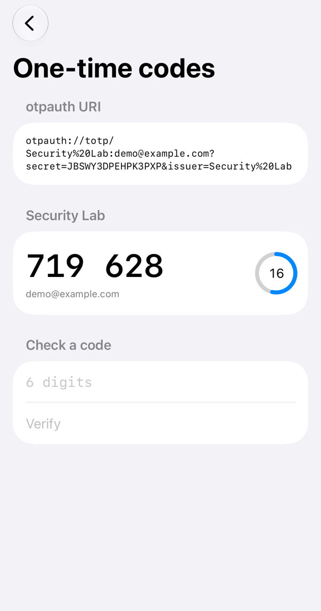
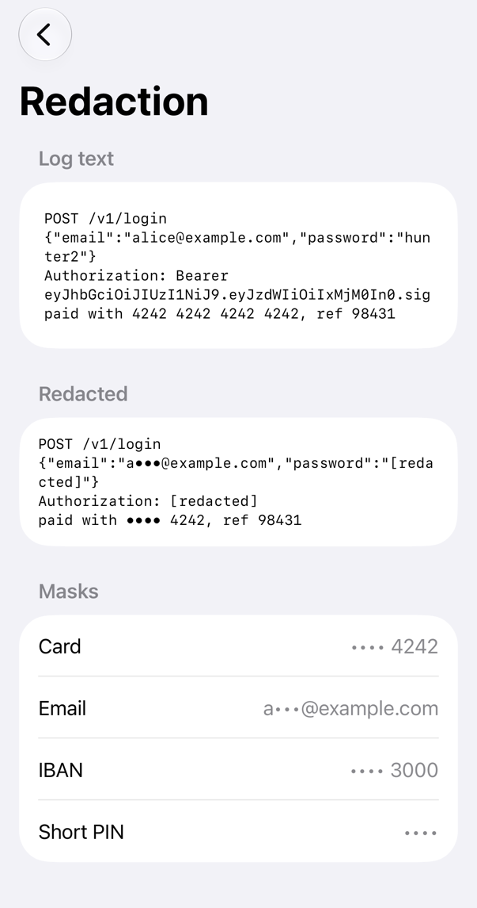
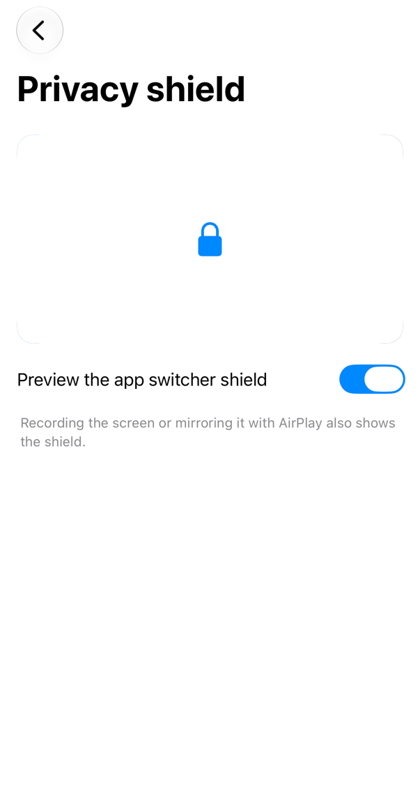

<!-- i18n-source: README.md@763d02d43529f0e0a9a5343f2672651fdc797a8b status=reviewed -->
<!-- brand:start -->

<p align="center"><picture><source media="(prefers-color-scheme: dark)" srcset="https://raw.githubusercontent.com/muhittincamdali/iOSSecurityTools/master/.github/brand/banner-zh-CN-dark.svg"><source media="(prefers-color-scheme: light)" srcset="https://raw.githubusercontent.com/muhittincamdali/iOSSecurityTools/master/.github/brand/banner-zh-CN-light.svg"></picture></p>

<!-- lang-selector:start -->
<p align="center"><a href="README.md">English</a> · <a href="README.tr.md">Türkçe</a> · <a href="README.zh-CN.md">简体中文</a> · <a href="README.ja.md">日本語</a> · <a href="README.ko.md">한국어</a> · <a href="README.es.md">Español</a> · <a href="README.de.md">Deutsch</a> · <a href="README.fr.md">Français</a> · <a href="README.pt-BR.md">Português (Brasil)</a> · <a href="README.ru.md">Русский</a></p>
<!-- lang-selector:end -->

<p align="center">
<a href="https://github.com/muhittincamdali/iOSSecurityTools/actions/workflows/ci.yml"></a>
<a href="https://github.com/muhittincamdali/iOSSecurityTools/releases"><picture><source media="(prefers-color-scheme: dark)" srcset="https://raw.githubusercontent.com/muhittincamdali/iOSSecurityTools/master/.github/brand/badge-version-dark.svg"><source media="(prefers-color-scheme: light)" srcset="https://raw.githubusercontent.com/muhittincamdali/iOSSecurityTools/master/.github/brand/badge-version-light.svg"></picture></a>
<a href="https://github.com/muhittincamdali/iOSSecurityTools/blob/master/Package.swift"><picture><source media="(prefers-color-scheme: dark)" srcset="https://raw.githubusercontent.com/muhittincamdali/iOSSecurityTools/master/.github/brand/badge-platforms-dark.svg"><source media="(prefers-color-scheme: light)" srcset="https://raw.githubusercontent.com/muhittincamdali/iOSSecurityTools/master/.github/brand/badge-platforms-light.svg"></picture></a>
<a href="https://github.com/muhittincamdali/iOSSecurityTools/blob/master/Package.swift"><picture><source media="(prefers-color-scheme: dark)" srcset="https://raw.githubusercontent.com/muhittincamdali/iOSSecurityTools/master/.github/brand/badge-language-dark.svg"><source media="(prefers-color-scheme: light)" srcset="https://raw.githubusercontent.com/muhittincamdali/iOSSecurityTools/master/.github/brand/badge-language-light.svg"></picture></a>
<a href="https://github.com/muhittincamdali/iOSSecurityTools/blob/master/LICENSE"><picture><source media="(prefers-color-scheme: dark)" srcset="https://raw.githubusercontent.com/muhittincamdali/iOSSecurityTools/master/.github/brand/badge-license-dark.svg"><source media="(prefers-color-scheme: light)" srcset="https://raw.githubusercontent.com/muhittincamdali/iOSSecurityTools/master/.github/brand/badge-license-light.svg"></picture></a>
</p>

<p align="center">
<a href="#快速开始"><picture><source media="(prefers-color-scheme: dark)" srcset="https://raw.githubusercontent.com/muhittincamdali/iOSSecurityTools/master/.github/brand/button-start-zh-CN-dark.svg"><source media="(prefers-color-scheme: light)" srcset="https://raw.githubusercontent.com/muhittincamdali/iOSSecurityTools/master/.github/brand/button-start-zh-CN-light.svg"></picture></a>
<a href="https://muhittincamdali.github.io/iOSSecurityTools/documentation/iossecuritytools/"><picture><source media="(prefers-color-scheme: dark)" srcset="https://raw.githubusercontent.com/muhittincamdali/iOSSecurityTools/master/.github/brand/button-docs-zh-CN-dark.svg"><source media="(prefers-color-scheme: light)" srcset="https://raw.githubusercontent.com/muhittincamdali/iOSSecurityTools/master/.github/brand/button-docs-zh-CN-light.svg"></picture></a>
<a href="https://github.com/muhittincamdali/iOSSecurityTools/tree/master/Examples"><picture><source media="(prefers-color-scheme: dark)" srcset="https://raw.githubusercontent.com/muhittincamdali/iOSSecurityTools/master/.github/brand/button-examples-zh-CN-dark.svg"><source media="(prefers-color-scheme: light)" srcset="https://raw.githubusercontent.com/muhittincamdali/iOSSecurityTools/master/.github/brand/button-examples-zh-CN-light.svg"></picture></a>
</p>

> 本文是英文 README 的译文。如两者内容不一致，以英文版为准。

<!-- brand:end -->

一个面向 iOS、macOS、tvOS、watchOS 和 visionOS 应用的 Swift 安全组件包：钥匙串存储、认证加密、PIN 哈希、Secure Enclave 密钥、证书固定、一次性密码、设备完整性检查和日志脱敏。它适合希望正确实现这些功能、又不想研究 Security framework 的 C API 的应用开发者。每个类型都会校验收到的输入，并抛出带类型的错误而不是崩溃，因此来自二维码、服务器或文件的值不会让应用陷入崩溃。该软件包没有任何依赖。

## 亮点

- **无需手写字典的钥匙串** —— `Keychain` 可以存储数据、字符串和 `Codable` 值，在首次使用时创建加密密钥，并可要求 Face ID、Touch ID 或设备密码；这一限制由钥匙串本身强制执行，而不是靠 `LAContext` 外面的一个 `if`。
- **能发现篡改的加密** —— `DataCipher` 写出 AES-256-GCM 或 ChaCha20-Poly1305 信封，信封中自带版本、算法和 nonce；任何一个字节被改动、密钥错误或关联数据错误，都会导致解密失败。同时提供 HKDF、PBKDF2 和 PHC 格式的 PIN 哈希。
- **不会把用户锁在门外的证书固定** —— `PinningPolicy` 要求提供备用 pin，支持子域名、过期日期和仅报告模式，并且仍要求系统自身的信任评估通过。
- **提供信号，而非承诺** —— `IntegrityInspector` 以 `Codable` 报告的形式给出越狱文件、调试器、模拟器、hook 库和系统代理的检测结果；文档也会说明攻击者能够隐藏哪些内容。
- **机密不会出现在日志和截图中** —— `@Redacted` 在任何地方都输出 `<redacted>`；`SensitiveDataRedactor` 会清除银行卡号、电子邮件、token 和密码字段（即使它们被零宽字符或全角字符隐藏）；`.privacyShield()` 会在 App 切换器和屏幕录制期间遮住视图。
- **经受过恶意输入的测试** —— RFC 4226、6238 和 5869 的测试向量，由独立实现生成的信封和哈希，来自测试 PKI 的证书链，NaN 和无穷大的日期，`Int.min` 和 `Int.max`，过大和重复的 URI 参数：在 macOS 和 iPhone 模拟器上共有 157 个 Swift Testing 测试，另外还有示例应用内部的钥匙串测试套件。

### 包含的内容

| 领域 | 类型 |
| --- | --- |
| 钥匙串 | `Keychain`, `KeychainAccessibility`, `KeychainProtection`, `KeychainError` |
| 加密与哈希 | `DataCipher`, `KeyDerivation`, `PasswordKeyDerivation`, `PasswordHash`, `SecureRandom`, `ConstantTime` |
| Secure Enclave | `SecureEnclaveKey`, `Keychain.secureEnclaveKey(forKey:protection:)` |
| 生物识别 | `BiometricAuthenticator`, `BiometricError` (iOS, macOS, visionOS) |
| 证书固定 | `PinningPolicy`, `PinnedDomain`, `SPKIPin`, `PinningURLSessionDelegate`, `URLSession.pinned(policy:)` |
| 一次性密码 | `TOTP`, `HOTP`, `OTPAuthURI` |
| 设备完整性 | `IntegrityInspector`, `IntegrityReport`, `IntegrityFinding` |
| 日志与屏幕 | `Redacted`, `Mask`, `SensitiveDataRedactor`, `.privacyShield(when:)`, `.onScreenshot(perform:)` |

## 快速开始

**1. 添加软件包**

在 Xcode 中选择 **File › Add Package Dependencies…**，然后输入仓库地址：

```text
https://github.com/muhittincamdali/iOSSecurityTools.git
```

将地址粘贴到窗口右上角的搜索框中。保持 **Dependency Rule** 为从 `2.0.0` 起的 **Up to Next Major Version**，然后点击 **Add Package**。在下一个窗口中，在 **iOSSecurityTools** 旁选择你的 App target，再次点击 **Add Package**。

**2. 导入模块**

```swift
import iOSSecurityTools
```

把这一行放在使用该软件包的 Swift 文件顶部，位于 `import SwiftUI` 之下。

**3. 开始使用**

在一个新的 Xcode App 项目中（**File › New › Project… › App**），用下面的代码替换 `ContentView.swift` 的全部内容：

```swift
import SwiftUI
import iOSSecurityTools

struct ContentView: View {
    @State private var status = "Nothing stored yet"

    var body: some View {
        VStack(spacing: 16) {
            Text(status)
            Button("Encrypt and store a note") {
                do {
                    let keychain = Keychain(service: "QuickStart")
                    let cipher = try DataCipher(key: keychain.symmetricKey(forKey: "notes-key"))
                    try keychain.set(cipher.encrypt("Meet at 7 pm"), forKey: "note")

                    let stored = try keychain.data(forKey: "note") ?? Data()
                    status = "Decrypted: \(try cipher.decryptString(stored))"
                } catch {
                    status = error.localizedDescription
                }
            }
            .buttonStyle(.borderedProminent)
        }
        .padding()
        .privacyShield()
    }
}
```

选择一个 iPhone 模拟器并点击 **Run**（⌘R）。点击按钮后，应用会在钥匙串中创建一个密钥，用它加密这条笔记，存储加密后的字节，再读回并显示 "Decrypted: Meet at 7 pm"。`.privacyShield()` 会在应用进入后台时用一个锁屏覆盖画面，因此 App 切换器不会显示这条笔记。

## 安装

### Swift Package Manager

在 Xcode 中选择 **File › Add Package Dependencies…**，然后输入仓库地址：

```text
https://github.com/muhittincamdali/iOSSecurityTools.git
```

或者将其添加到 `Package.swift` 的 `dependencies` 中：

```swift
dependencies: [
    .package(url: "https://github.com/muhittincamdali/iOSSecurityTools.git", from: "2.0.0")
],
targets: [
    .target(name: "YourApp", dependencies: [
        .product(name: "iOSSecurityTools", package: "iOSSecurityTools")
    ])
]
```

2.0.0 版（2026 年 10 月）是当前软件包的首个发布版本。更早的 1.0.0 版（2026 年 2 月）是另一套代码：2026 年 6 月，它的源代码被替换成了占位代码，2026 年 10 月，该软件包连同测试一起被完全重写。变更列表见 [CHANGELOG.md](CHANGELOG.md)。

macOS 应用要使用钥匙串，需要在 **Signing & Capabilities** 中设置开发团队；iOS 应用和模拟器无需额外设置。若要使用 Face ID，请在应用的 Info.plist 中添加 `NSFaceIDUsageDescription`。

## 使用方法

下面的示例复制自 [`Examples/SecurityLab/SecurityLab/ReadmeSamples.swift`](Examples/SecurityLab/SecurityLab/ReadmeSamples.swift)。示例应用和测试套件都会编译这个文件，测试会运行其中不需要弹出提示或联网的示例。

### 在钥匙串中存储 token

```swift
func keychainSample() throws -> String? {
    let keychain = Keychain(service: "com.example.app.credentials")
    try keychain.set("r-7f3a9c", forKey: "refreshToken")
    let token = try keychain.string(forKey: "refreshToken")   // "r-7f3a9c"
    try keychain.removeValue(forKey: "refreshToken")
    return token
}
```

### 要求用 Face ID 访问某个值

```swift
func protectedValueSample() throws -> String? {
    let keychain = Keychain(service: "com.example.app.cards")
    // Only the biometry enrolled now can read the value; the system enforces it.
    try keychain.set("4921", forKey: "card-pin", protection: .biometryCurrentSet)
    return try keychain.string(forKey: "card-pin", prompt: "Show your card PIN")
}
```

### 加密一条记录

```swift
func encryptionSample() throws -> String {
    let cipher = try DataCipher(key: DataCipher.generateKey())
    let recordID = Data("note-42".utf8)

    // The record ID is authenticated, so this envelope cannot be pasted into another record.
    let envelope = try cipher.encrypt("Meet at 7 pm", authenticating: recordID)
    return try cipher.decryptString(envelope, authenticating: recordID)   // "Meet at 7 pm"
}
```

### 校验应用锁 PIN

```swift
func pinSample() throws -> Bool {
    let stored = try PasswordHash.make(for: "4921")          // "$pbkdf2-sha256$i=600000$..."
    return try PasswordHash.verify("4921", against: stored)   // true
}
```

### 根据二维码显示一次性验证码

```swift
func oneTimePasswordSample() throws -> Bool {
    let scanned = "otpauth://totp/Example:alice@example.com?secret=JBSWY3DPEHPK3PXP&issuer=Example"
    let uri = try OTPAuthURI(parsing: scanned)
    guard case .totp(let totp) = uri.kind else { return false }

    let code = try totp.code()                    // six digits, new every 30 seconds
    let secondsLeft = try totp.secondsRemaining()
    print("\(uri.issuer ?? ""): \(code), \(secondsLeft) s left")
    return try totp.verify(code)                   // also accepts the previous and next code
}
```

### 固定服务器的密钥

```swift
func pinnedSessionSample() throws -> URLSession {
    let policy = try PinningPolicy([
        PinnedDomain("letsencrypt.org", pins: [
            "C5+lpZ7tcVwmwQIMcRtPbsQtWLABXhQzejna0wHFr8M=",   // ISRG Root X1
            "diGVwiVYbubAI3RW4hB9xU8e/CH2GnkuvVFZE8zmgzI=",   // ISRG Root X2
        ], includesSubdomains: true),
    ])
    return URLSession.pinned(policy: policy) { failure in
        print("Blocked: \(failure.localizedDescription)")
    }
}
```

[证书固定指南](https://muhittincamdali.github.io/iOSSecurityTools/documentation/iossecuritytools/pinningcertificates)介绍了如何获取你自己服务器的 pin，以及如何在不把用户锁在门外的前提下逐步上线。

### 检查设备

```swift
func integritySample() -> IntegrityReport {
    let report = IntegrityInspector().inspect()
    if report.hasFindings(in: [.jailbreak, .injectedLibraries]) {
        // Add friction: ask for the passcode again, lower limits, flag the session on the server.
    }
    for finding in report.findings {
        print(finding)   // for example "Running in the simulator"
    }
    return report
}
```

### 让机密远离日志

```swift
struct LoginRequest: Codable {
    var username: String
    @Redacted var password: String
}

func redactionSample() -> (request: String, log: String) {
    let request = LoginRequest(username: "alice", password: "hunter2")
    let printed = "\(request)"   // LoginRequest(username: "alice", _password: <redacted>)

    let redactor = SensitiveDataRedactor()
    let log = redactor.redact("card=4242 4242 4242 4242 email=alice@example.com token=eyJhbGciOiJIUzI1NiJ9.eyJzdWIiOiIxIn0.c2ln")
    // "card=•••• 4242 email=a•••@example.com token=[redacted]"
    return (printed, log)
}
```

### 将账户绑定到设备

```swift
func deviceBindingSample(challenge: Data) throws -> (publicKey: Data, signature: Data)? {
    guard SecureEnclaveKey.isAvailable else { return nil }
    let key = try Keychain(service: "com.example.app.device").secureEnclaveKey(forKey: "device-key")
    // Send key.publicKeyDER to the server once; afterwards sign its login challenges.
    return (key.publicKeyDER, try key.signature(for: challenge))
}
```

## 演示

SecurityLab 示例应用在 iPhone 模拟器上的界面，由 [`scripts/capture-example-screens.sh`](scripts/capture-example-screens.sh) 从运行中的应用截取：

| 完整性                                                                                              | 保险库                                                                                   | 一次性验证码                                                                       |
| --------------------------------------------------------------------------------------------------- | ---------------------------------------------------------------------------------------- | ---------------------------------------------------------------------------------- |
| <picture><source media="(prefers-color-scheme: dark)" srcset="docs/images/example-integrity-dark.png"></picture> | <picture><source media="(prefers-color-scheme: dark)" srcset="docs/images/example-vault-dark.png"></picture> | <picture><source media="(prefers-color-scheme: dark)" srcset="docs/images/example-codes-dark.png"></picture> |

| 脱敏                                                                                             | 隐私屏障                                                |
| ------------------------------------------------------------------------------------------------ | ------------------------------------------------------- |
| <picture><source media="(prefers-color-scheme: dark)" srcset="docs/images/example-redaction-dark.png"></picture> | <picture><source media="(prefers-color-scheme: dark)" srcset="docs/images/example-privacy-dark.png"></picture> |

要运行该应用，请用 Xcode 打开 [`Examples/SecurityLab`](Examples/SecurityLab) 中的 `SecurityLab.xcodeproj`，选择一个 iPhone 模拟器或 **My Mac**，然后点击 **Run**。应用中还包含快速开始示例，以及一个证书固定页面，它会连接服务器并列出其证书链的 pin；详情见 [Examples/README.md](Examples/README.md)。

## 文档

API 参考文档与文章：

- [API 参考](https://muhittincamdali.github.io/iOSSecurityTools/documentation/iossecuritytools/)（DocC，从 `master` 发布到 GitHub Pages）
- 在 Xcode 中通过 **Product › Build Documentation** 在本地构建，或使用命令行：

```sh
xcodebuild docbuild -scheme iOSSecurityTools -destination 'generic/platform=macOS'
```

## 指南

- [快速入门](https://muhittincamdali.github.io/iOSSecurityTools/documentation/iossecuritytools/gettingstarted) —— 添加软件包，把一条笔记加密存入钥匙串，并遮住屏幕（[源文件](Sources/iOSSecurityTools/iOSSecurityTools.docc/GettingStarted.md)）。
- [存储机密](https://muhittincamdali.github.io/iOSSecurityTools/documentation/iossecuritytools/storingsecrets) —— 可访问性、生物识别保护、加密密钥、PIN 哈希和 Secure Enclave 密钥（[源文件](Sources/iOSSecurityTools/iOSSecurityTools.docc/StoringSecrets.md)）。
- [证书固定](https://muhittincamdali.github.io/iOSSecurityTools/documentation/iossecuritytools/pinningcertificates) —— 获取 pin、选择备用 pin、仅报告模式的逐步上线以及过期处理（[源文件](Sources/iOSSecurityTools/iOSSecurityTools.docc/PinningCertificates.md)）。
- [检测被入侵的设备](https://muhittincamdali.github.io/iOSSecurityTools/documentation/iossecuritytools/detectingcompromiseddevices) —— 每项完整性检查能看到什么、看不到什么，以及何时应使用 App Attest（[源文件](Sources/iOSSecurityTools/iOSSecurityTools.docc/DetectingCompromisedDevices.md)）。
- [让机密远离日志](https://muhittincamdali.github.io/iOSSecurityTools/documentation/iossecuritytools/keepingsecretsoutoflogs) —— `Redacted`、掩码、脱敏器和隐私屏障（[源文件](Sources/iOSSecurityTools/iOSSecurityTools.docc/KeepingSecretsOutOfLogs.md)）。

## 系统要求

| 平台 | 最低版本 |
| --- | --- |
| iOS | 17 |
| macOS | 14 |
| tvOS | 17 |
| watchOS | 10 |
| visionOS | 1 |
| 工具链 | Swift 6.2 · Xcode 26+ |

`BiometricAuthenticator` 在没有生物识别功能的 tvOS 和 watchOS 上不可用。CI 使用 GitHub `macos-26` runner 镜像自带的默认 Xcode 构建。该软件包使用 Xcode 27 开发。

## 架构

- `Sources/iOSSecurityTools/<Area>/` 中每个功能领域对应一个文件夹：`Keychain`、`Crypto`、`Random`、`SecureEnclave`、`Biometrics`、`Pinning`、`OneTimePassword`、`Integrity`、`Redaction` 和 `Privacy`。除了 `URLSession` 要求必须是类的 `PinningURLSessionDelegate` 之外，所有类型都是 `Sendable` 的值类型。
- 软件包直接调用 Apple 的 framework —— 用 Security 处理钥匙串和信任评估，用 CryptoKit 处理 AES-GCM、ChaCha20-Poly1305、HKDF、HMAC 和 Secure Enclave，用 CommonCrypto 处理 PBKDF2，用 LocalAuthentication 处理生物识别 —— 只实现它们所缺少的部分：信封格式、用于 pin 的 SubjectPublicKeyInfo 编码、HOTP/TOTP 截断、Base32、PHC 哈希格式和脱敏扫描器。
- 错误是带类型的（`throws(KeychainError)`、`throws(CipherError)` 等），每个枚举 case 都有描述。来自应用外部的值会在执行任何处理之前先检查其限制。
- 读取系统状态的代码（完整性检查、`LAContext`）都经过小型的内部 protocol，因此测试可以用 fake 对象覆盖每个分支，同时也会检查真实的实现。
- 软件包不做什么，同样是设计的一部分：不使用 `ptrace` deny-attach，不使用 method swizzling，不读取私有的 dyld 结构。这些做法在不同系统版本之间容易失效，也很容易被绕过；[完整性指南](https://muhittincamdali.github.io/iOSSecurityTools/documentation/iossecuritytools/detectingcompromiseddevices)建议改用 App Attest。
- CI 会在 macOS 上运行 `swift test`，在 iPhone 模拟器上运行 `xcodebuild test`，为全部五个平台构建，为 iOS 和 macOS 构建示例应用，在应用内运行它的测试，并发布 DocC 文档。

在本地运行测试：

```sh
swift test                                    # macOS
xcodebuild test -scheme iOSSecurityTools \
  -destination 'platform=iOS Simulator,name=iPhone 17'
```

在模拟器上，没有宿主应用的测试 bundle 不具备钥匙串 entitlement，因此软件包的钥匙串测试套件在那里是在示例应用内运行的：

```sh
cd Examples/SecurityLab
xcodebuild test -scheme SecurityLab -destination 'platform=iOS Simulator,name=iPhone 17'
```

## 路线图

- 提供一个 App Attest 封装（`DCAppAttestService`），并附带服务端验证示例。
- 将该软件包加入 Swift Package Index；`.spi.yml` 已在仓库中。

## 参与贡献

欢迎参与贡献。提交 pull request 之前，请先阅读[贡献指南](https://github.com/muhittincamdali/iOSSecurityTools/blob/master/CONTRIBUTING.md)和[行为准则](https://github.com/muhittincamdali/.github/blob/main/CODE_OF_CONDUCT.md)。如发现安全问题，请按照[安全策略](https://github.com/muhittincamdali/iOSSecurityTools/blob/master/SECURITY.md)私下报告。

## 许可证

基于 MIT 许可证发布。详见 [LICENSE](LICENSE)。
